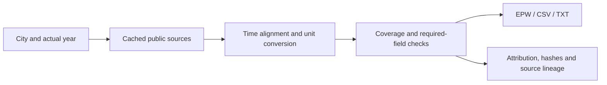

# pyEPW

[](https://github.com/BehnamMohseniGharyehsafa/pyEPW/actions/workflows/tests.yml)
[](pyproject.toml)
[](LICENSE)

**A city. An actual year. An EPW file you can trace back to its sources.**

Generate `.epw`, `.csv` and `.txt` from ERA5 reanalysis, with documented
astronomical/empirical calculations and optional public-data supplements.
Actual calendar years, leap days, fixed standard time and explicit missing data.

[Quick start](#install) · [Six-continent gallery](docs/gallery.md) ·
[Architecture & UML](docs/architecture.md) · [Python API](docs/api.md) ·
[Sources & attribution](DATA_SOURCES.md) · [Usage conditions](docs/legal.md)

```python
import pyEPW

weather = pyEPW.EPW("Dublin, Ireland", "2024", ".epw")
weather.to_csv()
weather.to_txt()
weather.to_analysis_csv()
print(weather.quality_report())
```

The package retrieves the requested calendar year's ERA5 reanalysis, retains
leap days, and exports `.epw`, `.txt`, or `.csv`. Additional exports reuse the
same loaded data. Each output includes a separate provenance/attribution file.

This is an independent community library. It is not an official Open-Meteo
product. Source code and release bundles are maintained in this GitHub repository.
The distribution has not been published to PyPI.

The Python import is **`pyEPW`**, with that exact capitalization. The installable
distribution is **`pyepw-openmeteo`**. The unrelated name `pyepw` is already used
on PyPI; `pip install pyEPW` would select that other project. Install this
project from this repository or the provided wheel using the instructions below.


*Actual 2024 ERA5 profiles from six generated city files. Model values, not local
thermometer observations. [Data, attribution and reproduction](docs/gallery.md).*

## Install

Python **3.10+** is required. From this project folder:

```shell
python -m pip install .
```

For development:

```shell
python -m pip install -e ".[dev]"
```

Or install directly from this repository:

```shell
python -m pip install "git+https://github.com/BehnamMohseniGharyehsafa/pyEPW.git"
```

A built wheel can be shared and installed directly:

```shell
python -m pip install dist/pyepw_openmeteo-0.4.1-py3-none-any.whl
```

Runtime dependencies are limited to the free `tzdata` timezone database; pandas,
numpy, requests and paid weather/conversion services are not required.

## Python usage

Both import styles work:

```python
import pyEPW

weather = pyEPW.EPW("Paris, France", "2023", "csv")
```

```python
from pyEPW import EPW

weather = EPW("Dublin, Ireland", 2024, "epw", output_dir="weather")
print(weather.path)
print(weather.hours)          # 8784 in a leap year
print(weather.location)

csv_path = weather.to_csv()   # no additional weather download
text_path = weather.to_txt()
print(weather.metadata)
```

Use `weather` as the result variable. `EPW = EPW(...)` would replace the class
name in your Python session after that first call.

The constructor accepts integer/string years and formats such as `"epw"`,
`".epw"`, `"CSV"`, and `".txt"`. It downloads and writes immediately. Importing
or viewing general usage help performs no network requests or file writes.

Default output is in `./output`, relative to the caller's working directory:

```text
output/
  Dublin_IE_2024.epw
  Dublin_IE_2024.epw.metadata.json
  Dublin_IE_2024.csv
  Dublin_IE_2024.csv.metadata.json
  Dublin_IE_2024.txt
  Dublin_IE_2024.txt.metadata.json
```

Existing files are preserved unless `overwrite=True` is supplied. An explicit
`output="path/file.csv"` can override the default destination.

## City names and help

```python
import pyEPW

print(pyEPW.help())
print(pyEPW.help("formats"))
print(pyEPW.help("fields"))
print(pyEPW.help("cities", query="Paris", country="FR"))

matches = pyEPW.search_cities("Dublin", country="IE")
for city in matches:
    print(city, city.latitude, city.longitude)

# List every name in the optional GeoNames catalog for a country.
print(pyEPW.help("cities", country="IE", limit=None))

# Export every city in the published global catalog.
catalog = pyEPW.CityCatalog.download()
catalog.export("all_cities.csv")
```

Online search uses Open-Meteo's global location service. The optional offline
catalog is downloaded once from GeoNames' **cities500** dataset, then cached in
SQLite. It includes cities with population over 500 and qualifying administrative
seats. It does **not** enumerate every settlement on Earth; live search can find
additional places. There is no hard-coded restriction to an example-city list.

Use `help(pyEPW.EPW)` for Python's standard API documentation. See the
[city directory guide](docs/cities.md) for listing, searching, and exporting names.

## Command line

```shell
pyEPW "Dublin, Ireland" 2024 --format epw
pyEPW "London" 2023 --country GB --format csv
pyEPW "New Delhi" 2024 --country IN --format txt
pyEPW cities Dublin --country IE
pyEPW cities --output all_cities.csv
pyEPW --help
```

`python -m pyEPW` provides the same CLI. The original
`python open_meteo_epw.py --city ... --year ...` launcher and `open-meteo-epw`
console command also remain available.
Use `--verbose` for progress, `--overwrite` to replace files, and `--cache-dir`
to choose a cache location. The library otherwise uses a user-writable cache,
not the installed package directory.

## Formats and weather quality

| Format | Contents |
|---|---|
| EPW | Eight EnergyPlus headers and 35 fields per hourly record |
| CSV | A row of unit-labelled column names and the same hourly records |
| TXT | Provenance comments followed by tab-delimited named columns and records |

Ordinary years contain **8,760** records; leap years contain **8,784**. The EPW
header dates include the actual year for EnergyPlus's actual-weather mode.
Timestamps use fixed local standard time without daylight saving. Fractional
UTC offsets are supported with documented resampling.

ERA5 is a model-based historical reconstruction. The library supplies these fields
by default, with their source and hourly coverage recorded separately:

| Fields | Source or method |
|---|---|
| Extraterrestrial horizontal and direct normal radiation | Integrated astronomical calculations |
| Global, direct normal and diffuse illuminance; zenith luminance | Published Perez (1990) empirical models using ERA5 radiation and dew point |
| Precipitable water | ERA5 total-column integrated water vapour |
| Visibility and ceiling height | Nearby NOAA GHCNh; gaps try QC-filtered NOAA ISD and published METAR reports |
| Days since last snowfall | Elapsed whole days from ERA5 hourly snowfall, including prior-year history; 88 means at least 88 days |
| Albedo | Valid NASA POWER/CERES hourly surface albedo; undefined nighttime ratios remain missing |

Photometry is modeled; nearby station reports are spatial proxies. Neither is
an on-site measurement at the requested coordinates. No method guarantees
complete or perfectly accurate weather for every city/year. Infrared radiation
and opaque sky cover remain estimates. Unavailable fields use official EPW
sentinel codes, retained in standard CSV/TXT. Missing core weather
stops the conversion. Ground temperatures and sizing-day statistics are not
invented. Only completed years from 1940 are accepted, subject to archive
boundaries and the approximately five-day ERA5 publication delay.

Use the analysis export to get blank cells for missing values and retain modeled
zenith luminance above EPW's representable non-missing range. The canonical EPW
and standard CSV correctly mark those out-of-range values as missing, without
clipping them. Ceiling codes `77777` (unlimited) and `88888` (cirroform) are
categories, not numerical heights. Visibility `10` may mean **at least 10 km**;
qualifiers and per-hour station/QC lineage are in the metadata.

```python
weather = EPW("Maynooth, Ireland", 2025, ".epw")
print(weather.quality_report())
print(weather.field_coverage["visibility_km"])
print(weather.is_complete)     # False if any canonical weather field has gaps
print(weather.missing_fields)  # field name -> missing hour count
analysis = weather.to_analysis_csv()  # *_analysis.csv, no further downloads

# Require complete coverage for selected fields before writing any output.
weather = EPW("Paris, France", 2024, output_dir="strict_weather",
              require_fields=["precipitable_water_mm"])

# Reject any remaining missing weather field before writing.
# This can raise DataError: no archive guarantees all 35 fields for every hour.
# EPW("Cork, Ireland", 2025, require_complete=True)

# Optional: disable nearby-station downloads, or select a GHCNh station explicitly.
# EPW("Maynooth, Ireland", 2025, station=None)
# EPW("Maynooth, Ireland", 2025, station="EII0000EIME")
```

The default station search tests up to ten GHCNh references, prioritizing
airport/aviation sites, within 30 km, matching reports within 15 minutes. Gaps
then try up to three nearby NOAA historical stations and their published METARs.
It does not interpolate or
carry reports forward. Override the distance/tolerance explicitly if needed;
increasing them changes the representativeness of the data. Set
`include_additional_fields=False` to reproduce the original basic conversion.
IEM describes its archive as having very little additional QC. Such values are
labelled separately from NOAA QC-passed records. Set `allow_metar_fallback=False`
to exclude them, or `use_free_fallbacks=False` to disable the new fallback sources
and snow-history/albedo downloads. Neither option invents replacements for gaps.
CLI options include `--quality-report`, `--station`, `--basic`,
`--no-free-fallbacks`, `--no-metar-fallback`, `--require-complete`, and
`--require-field precipitable_water_mm`.

See [methodology](docs/methodology.md), [formats and missing values](docs/formats.md),
and the [complete Python API](docs/api.md).

## Six continents, one actual year

| Europe | Africa | Asia | North America | South America | Oceania |
|---|---|---|---|---|---|
| Dublin | Cape Town | Tokyo | New York City | Santiago | Sydney |

The [gallery](docs/gallery.md) contains actual 2024 monthly profiles, per-field
coverage, source requests and executable examples. Every city has 8,784 records;
the leap day is retained. No source gap is filled merely to complete a chart.

```shell
python examples/continents.py --continent "South America" --year 2024
```

## How the library fits together



Read the [class UML, data flow and sequence diagrams](docs/architecture.md) for
module responsibilities, immutable records, source fallbacks and strict export
behavior. Additional formats reuse the loaded data.

## Fees, licence and credits

The **library code is MIT-licensed**. It uses public endpoints without an API key,
subscription, payment details, or a billing integration.

**The hosted free Open-Meteo API is for non-commercial use**, subject to its rate
limits and current terms. The code's licence and the downloaded data's licence
do not remove that hosted-service restriction. Future service availability and
terms cannot be guaranteed.

Weather credits: Open-Meteo; ERA5/ERA5-Land from Copernicus C3S/ECMWF;
station supplements from NOAA NCEI GHCNh/ISD, the originating networks and Iowa
Environmental Mesonet; albedo from NASA POWER/CERES SYN1deg. City data:
GeoNames, CC BY 4.0. Keep the metadata credits and modification descriptions when
sharing files. See [NOTICE](NOTICE), [Open-Meteo terms](https://open-meteo.com/en/terms),
and [data attribution](https://open-meteo.com/en/licence).

Every new export includes source-specific attribution and licence scopes. See
[DATA_SOURCES.md](DATA_SOURCES.md) and [publication/use conditions](docs/legal.md).
MIT covers the code; the hosted-service and downloaded products' terms still apply.

## Tests and distribution

A completed [ten-country, twenty-year validation](docs/validation.md)
checks 200 actual-year EPWs from the v0.1.0 core conversion against nearby station observations. Conversion and
calendars passed for all files, but station agreement varies: wind, rain and
temperature extremes need particular care. See the [reproduction workflow](validation/README.md)
for data sources, quality filters and limitations. A valid EPW does not guarantee
accurate weather at a specific building site.

The original benchmark does not validate the newly added fields. A separate
[version 0.2.0 study](docs/validation_v0_2.md) generated 200 enriched EPWs and
audited 1,753,200 hourly records, accepted station-source values, column-water
gaps, numerical solar references and complete-year solver processing.
It found major visibility/ceiling coverage gaps in some countries, a missed
automatic station candidate in Madrid, and upstream column-water gaps in
January–June 2024. Photometry remains empirical, without local photometer
validation. Read the field-specific results before assuming global completeness.

Version 0.3.0 has a separate [Cork 2025 source audit](docs/fallbacks.md).
The earlier global study describes version 0.2.0 and does not certify the new
fallbacks globally. Remaining source gaps are preserved and reported.


*Version 0.2.0, 2005–2024 snapshot. Station distance and reporting differences
matter; this is not fresh global validation of 0.4.1 supplements.*

```shell
python -m unittest discover -s tests -v
ruff check pyEPW open_meteo_epw tests examples
python -m build
python -m twine check dist/*
```

The offline tests cover calendars, hourly alignment, fractional UTC offsets,
weather validation, all output formats, city catalog behavior, caching, CLI
behavior, and import side effects. A GitHub Actions workflow is provided for
Windows, macOS and Linux. Live service checks are kept separate from offline CI.

See [CONTRIBUTING.md](CONTRIBUTING.md) for development and release preparation.
Public package-index publication is a separate step requiring a maintainer
account and an available distribution name.

Maintainer: [Behnam Mohseni Gharyehsafa](https://github.com/BehnamMohseniGharyehsafa).
For research use, cite [CITATION.cff](CITATION.cff) and the original data products.
Read [security reporting](SECURITY.md), [contributing](CONTRIBUTING.md) and
[community conduct](CODE_OF_CONDUCT.md) before opening an issue or pull request.

Version 0.4.0 renames the library without changing the weather calculations.
Existing `import open_meteo_epw` integrations remain supported as aliases of
`pyEPW`; new code should use the new import. `PYEPW_CACHE` overrides the default
user cache, and the older `OPEN_METEO_EPW_CACHE` variable remains accepted.
Pass `cache_dir` explicitly to reuse a previous cache directory after migration.
