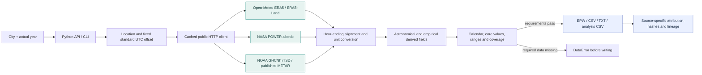
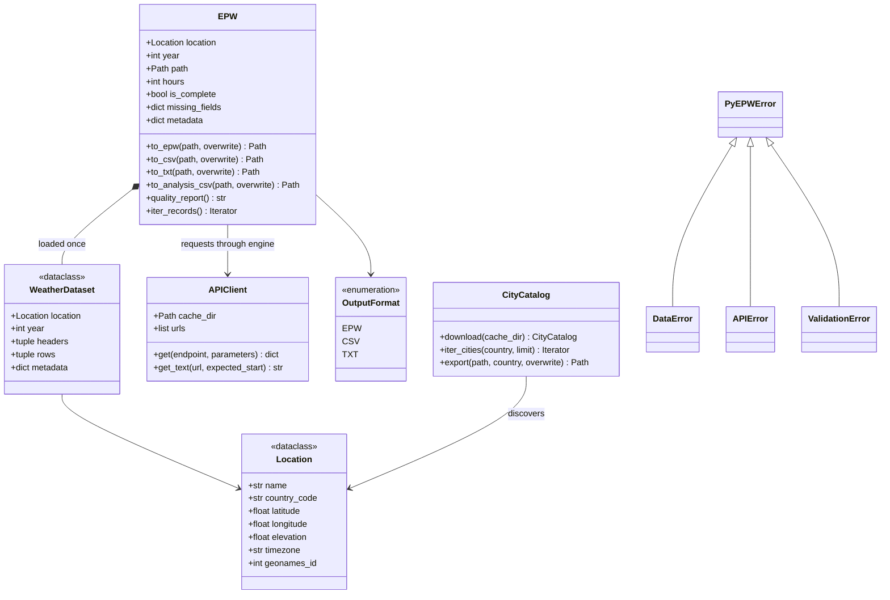
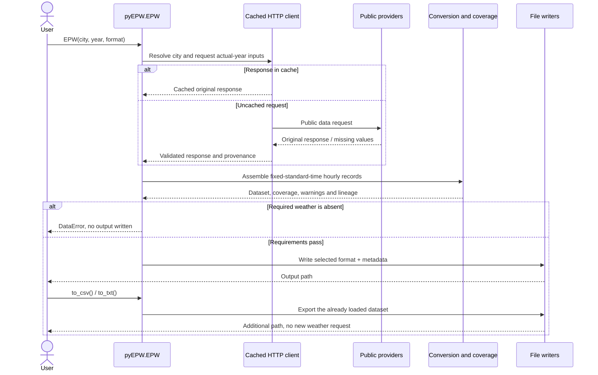

# Architecture and UML

The public entry point is `pyEPW.EPW(city, year, format)`. Construction resolves
the site, loads one actual calendar year, validates it and writes the selected
format. Additional exports use the same in-memory dataset. Importing the module
does not download data or create files.

## Data flow

Core missing data stops conversion. Optional unsupported values remain explicit
gaps unless a required-field check rejects the export. There is no generic
numeric replacement to make a file appear complete.

## Class diagram

`Location` and `WeatherDataset` are frozen dataclasses. Weather rows are immutable
tuples. Metadata properties return defensive copies. `OpenMeteoEPWError` and the
old `open_meteo_epw` namespace are compatibility aliases, not separate engines.

## Request and export sequence

## Source ownership

| Module | Responsibility |
|---|---|
| `api.py`, `cli.py` | Input validation and public entry points |
| `client.py`, `_files.py` | Bounded downloads, cache, hashes and atomic output |
| `_engine.py` | Actual-year calendar, resampling, units and assembly |
| `_solar.py`, `_daylight.py` | Astronomical integration and Perez photometry |
| `observations.py`, `station_fallbacks.py` | Source-aware QC, distance/time matching and gap-only station archives |
| `supplements.py` | ERA5 snowfall history and valid NASA albedo |
| `quality.py`, `_attribution.py` | Coverage/missing codes and source-specific credits |
| `writers.py` | Canonical formats, analysis export and metadata sidecars |

The [methodology](methodology.md) documents approximations and the
[source register](../DATA_SOURCES.md) documents data/access conditions.
