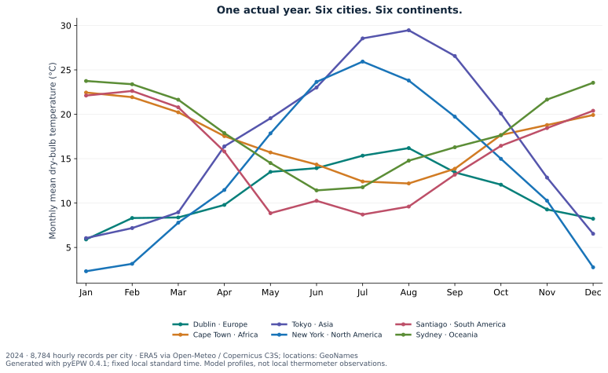
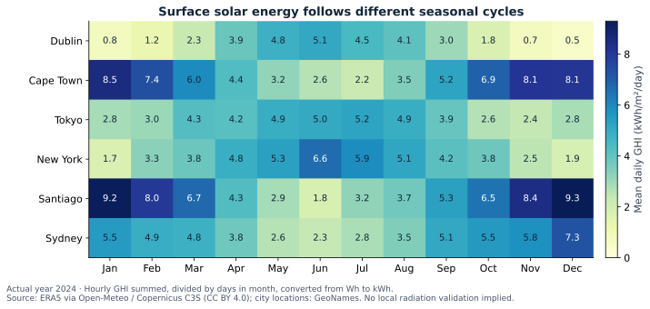
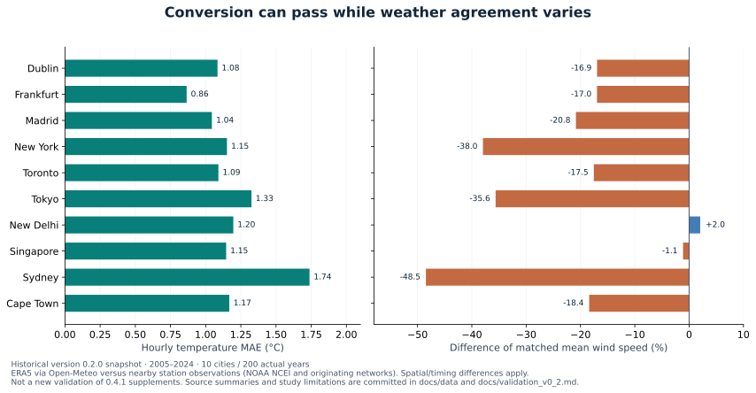

# Examples across six continents

All examples request one actual year. They do not construct a typical
meteorological year. The gallery uses **2024**, so each complete calendar has
**8,784 records**, including 29 February. Run examples sequentially and observe
upstream limits; live downloads are deliberately excluded from offline CI.

| Continent | City | Python example |
|---|---|---|
| Europe | Dublin, Ireland | `pyEPW.EPW("Dublin, Ireland", 2024, ".epw", country="IE")` |
| Africa | Cape Town, South Africa | `pyEPW.EPW("Cape Town, South Africa", 2024, ".epw", country="ZA")` |
| Asia | Tokyo, Japan | `pyEPW.EPW("Tokyo, Japan", 2024, ".epw", country="JP")` |
| North America | New York City, United States | `pyEPW.EPW("New York City, United States", 2024, ".epw", country="US")` |
| South America | Santiago, Chile | `pyEPW.EPW("Santiago, Chile", 2024, ".epw", country="CL")` |
| Oceania | Sydney, Australia | `pyEPW.EPW("Sydney, Australia", 2024, ".epw", country="AU")` |

## Seasonal profiles from the generated files



Each point is the arithmetic mean of hourly ERA5 dry-bulb temperatures in that
calendar month at the requested city coordinates. It is a descriptive model
profile, not a comparison against local thermometers. Southern and northern
hemisphere seasons differ; these six cities do not represent every climate on
their continent. [Inputs and provenance](data/README.md).



GHI is summed from hourly Wh/m², divided by days in the month and converted to
kWh/m²/day. It is ERA5-derived surface radiation, not extraterrestrial radiation
or a local pyranometer measurement. No missing sentinel is included in a mean.

## Run a chosen example

```shell
python examples/continents.py --continent "South America" --year 2024
python examples/continents.py --continent all --year 2024 --cache-dir .openmeteo_cache
```

The default example processes Europe only. Add `--overwrite` deliberately to
replace outputs. Downloads use public endpoints without an API key; upstream
non-commercial/service limits still apply.

```python
import pyEPW

weather = pyEPW.EPW("Santiago, Chile", 2024, ".epw", output_dir="weather")
weather.to_csv()
weather.to_txt()
weather.to_analysis_csv()  # blanks for missing values; full modeled luminance
print(weather.hours)
print(weather.missing_fields)
print(weather.metadata["source_attributions"])
```

Canonical CSV/TXT preserve EPW missing codes. Albedo, station coverage, column
water and representable modeled luminance can have gaps. Present-weather codes
and aerosol optical depth remain unsupported. `require_complete=True` rejects
remaining missing weather fields; it does not manufacture a complete dataset.

## Historical benchmark, kept separate



These are the **version 0.2.0, 2005–2024** city-to-nearby-station results. They
are not fresh validation of every 0.4.1 field. Differences include model error,
distance, exposure, elevation and reporting precision. The city points and
airport stations are not colocated; the observing network may overlap ERA5
assimilation inputs. Read the [study limitations](validation_v0_2.md).

Regenerate the committed figures without downloading weather:

```shell
python -m pip install ".[docs]"
python tools/build_figures.py
```
